# TypedSolid 設計

## 目的

意味情報と設計・製造ルールを持つプログラマブルなソリッドモデリング基盤を構築する。主用途は3Dプリント向けの筐体・支持具である。形状の生成だけでなく、部品の独立性、強度上の弱点、基板やコネクタの空間、組立・保守時のアクセスを検証対象にする。

新規B-Repカーネルは開発しない。Rustが意味付き中間表現（IR）とルール判定を管理し、Python APIから使用する。初期backendはCadQuery/OCCTとし、将来のbackend変更が公開モデル全体に波及しない境界を設ける。

## 要求と評価段階

| 要求 | 対応方針 | 初期実装 |
|---|---|---|
| 孤立パーツを避ける | 最終Boolean結果のsolid数を検査 | 対応 |
| 1 STL＝1部品 | 検査済みPartごとにSTL/STEPを出力 | 対応 |
| 出力STLが閉じた立体である | 書き出したmeshのmanifold性、向き、連結成分、体積を検査 | 対応 |
| 細く折れやすい箇所を減らす | primitive寸法、最終肉厚、接続部断面、荷重・積層方向を段階的に評価 | primitive寸法、最終肉厚、接続部断面 |
| 閉じた空洞を避ける | 最終形状の空領域が外部へ通じているかを検査 | 対応 |
| 基板等のスペース確保 | clearanceで拡張したkeepoutと最終形状の交差体積を評価 | 軸平行box、面ごとのclearance |
| アクセスの確保 | 部品・工具の移動領域と形状の干渉検査 | 全部品に対する6方向の直線経路 |
| ネジ固定 | ネジ・インサートの寸法と実形状の整合を検査 | 貫通穴、座面、かかり長さ、先端の逃げ、bossの肉厚 |
| snap fit | 梁のひずみ、積層方向、たわむ空間、保持、外れる経路を検査 | 矩形断面の片持ち梁 |
| サポート不要化 | 印刷方向、overhang、bridge、閉空洞、層ごとの島を評価 | 印刷方向、overhang、bridge |
| 応力・熱解析 | 材料、境界条件、解析mesh、solverの条件を明示して連携 | 部品ごとの線形弾性 (等方性、層間の許容応力) と定常熱伝導。voxelの有限要素法、3段の格子で収束を判定 |

「中空を減らす」は内部を一律に埋める規則にはしない。基板空間・軽量化・放熱と競合するため、閉じた空洞や支持のない天井を制約し、必要な開放空間を保持する。infill率はslicer設定であり、CADの空洞と区別する。

## 境界と責務

| 層 | 責務 | 持たない責務 |
|---|---|---|
| Python API | typed dataclassによるモデル組立、serialization、部品catalog | 検証の独自再実装 |
| Rust core | schema、単位、ID、role、入力検証、preflight、出力判定 | OCCTオブジェクト保持 |
| PyO3 binding | JSON境界でcoreを呼ぶ | CAD処理 |
| CadQuery backend | IR→形状、最終solid・干渉検査、STL/STEP出力 | 未対応ルールの合格判定 |

JSONは初期のFFI・保存境界であり、Python scriptの文字列を評価しない。今後の性能測定で問題になるまで、独自の複雑なFFIオブジェクト共有を導入しない。

部品catalogはIRを組み立てるための寸法データであり、検証には関与しない。catalogが返す`Keepout`と`Feature`は手で書いたものと区別されず、同じRust coreで検証される。値はすべて公式資料が寸法線として与える数値に限り、記載のない項目は`None`として利用側に指定を求める。詳細は [部品catalog](catalog.md) を参照する。

## IR v13

- 長さはmm。座標は右手系で全Part共通、+Zを上方とする。回転・配置変換はまだ扱わない。
- `Model`は`schema_version=13`、`parts`、`keepouts`、`sweeps`、`assembly`、`fasteners`、`materials`、`snap_fits`、`connectors`、`analyses`、`policy`を持つ。`analyses`は解析ケースを持たなければ出力を省く。
- `Part`は単独の製造部品。`Feature`のIDはPart内で一意、Part IDとKeepout IDは各名前空間内で一意とする。
- `Part`は製造案`manufacturing` (1〜16件) と、そのうち採用する案のid`adopted`を持つ。IRに記述した座標は組立状態の姿勢であり、製造時の姿勢は製造案が持つ。詳細は [製造案](#製造案) を参照する。
- `Feature`は`shape`、`role`、`operation`を持つ。roleは`base/wall/mount/rib/generic`。roleだけで強度を保証しない。
- `shape`は`kind`で分岐する。`box`は`min`/`max`、`cylinder`は`axis`、軸に垂直な平面上の`center`、`radius`、軸方向の`span`を持つ。cylinderは軸平行に限る。任意軸は配置変換とあわせて後続項目とする。
- 穴は`operation=cut`のcylinder、bossは`add`のcylinderで表す。面取り・filletはOCCTのedge選択に依存するため導入しない。
- Booleanの意味は「すべてのAddの和から、すべてのCutを引く」。記述順依存の逐次CSGではない。Cutは生成用であり、最小feature寸法ルールの対象外。
- 最小feature寸法はprimitiveの寸法を測る。cylinderは直径と高さの小さい方とする。
- `Keepout`は確保領域と面ごとのclearanceを持つ。`clearance_mm`は`default`と面名 (`minus_x`等) の上書きからなる。支持面へ接触させる面だけを0にでき、他の面の要求は残る。
- keepoutはboxに限る。面別clearanceと、それを掃引に使うkeepout参照はboxの面を前提とするため、cylinderのkeepoutは受理しない。
- `Keepout.attached_to`は、基板などが固定されている部品のidである。keepoutは分解経路の障害物となり、取付先の部品を動かすstepではその部品と一緒に動き、以降の状態から除かれる。省略すると外部に固定され、最後まで残る。
- `Sweep`は工具・ケーブル・コネクタ、またはkeepoutを取り出す際に通る領域を表す。形状は`shape` (boxか軸平行cylinder) で直接与えるか、`keepout`を参照してそのclearance込みのboxを使う。どちらか一方に限る。`direction`、`distance_mm` (正の数値か`"exit"`) を持つ。形状は包絡であり、指の入る余地などの余裕を含める。掃引自体はclearanceを持たない。
- `after_step`を与えた掃引は、そのstepを終えた状態で評価し、取り外した部品は障害物にならない。省略すると組立完了の状態で評価する。USBは蓋を閉じたまま抜き差しでき、ネジは蓋を外してから締める、といった区別をこれで表す。
- IDは小文字ASCII英字で始まり、小文字英数字とunderscoreのみ、64文字以内。path traversalとWindows予約名を拒否する。
- `Policy`は`min_feature_mm`、`mesh_volume_tolerance`、`required`のほか、最終形状の検査に`voxel_mm`と`min_neck_mm`を持つ。いずれも製造法に依らない値である。肉厚、積層方向、overhang、bridgeは製造法に依るため、製造案が持つ。primitiveの寸法と最終形状の肉厚は別の概念であり、要求値も分けて指定する。
- `assembly`は分解手順を持つ。IRに記述した部品位置を組立完了の状態とし、`steps`を順に実行して分解する。各stepは`parts`を一体として、軸平行の直線区間を連ねた`path`に沿って動かし、以降の状態から除く。組立順序は分解の逆とする。どのstepにも現れない部品は最後まで残る。
- 区間の`distance_mm`は正の数値か`"exit"`とする。`"exit"`は残っている部品のAABBの外へ2 mmの余裕をもって出る距離を表し、最後の区間に限る。
- `fit_clearance_mm`は移動方向に垂直な向きに要求する隙間で、`assembly`の値をstepごとに上書きできる。既定の0では、形状同士が共通体積を持つ干渉だけを検出する。
- `Fastener`はネジ1本の固定を表し、`clamp`の部品を`base`の部品へ締める。`direction`は締め込む向き (頭から先端へ)、`center`は軸に垂直な面上の座標、`seat_mm`は頭の座面、`joint_mm`はclampとbaseの境目の軸方向の座標である。`screw`は長さ (座面から先端)、ねじ部の外径、頭の外径を、`through_mm`はclampの貫通穴の径を持つ。`anchor`は`self_tapping` (`pilot_mm`: 下穴径) か`insert` (`hole_mm`: 圧入前の下穴径、`length_mm`: インサート長。境目と面一に埋める) である。要求値として`min_engagement_mm`と`min_boss_wall_mm`を持つ。
- ネジ・インサートの寸法と要求値に既定値はなく、利用者が規格表や実測から与える。Rust coreは、外径 ≤ 貫通穴径 < 頭径、下穴径 < 外径 (セルフタップ)、インサート下穴径 > 外径、座面から見て境目が締め込む向きにあることを検証する。`clamp`が空の場合、締める対象は部品として記述されていない (基板など) ことを表し、座面と境目は一致してよい。
- `Material`は`id`、`name`、`source` (値の出典) と、曲げの許容ひずみ`allowable_strain` (無次元、0〜1) を持つ。`Part`は`material`でidを参照する。材料の値に既定値はない。解析に使う材料定数として、等方性の弾性定数`elastic` (`youngs_modulus_mpa`、`poisson_ratio`)、von Mises相当応力と比べる`allowable_stress_mpa`、積層方向の引張と比べる`interlayer_allowable_stress_mpa`、`thermal_conductivity_w_per_mk`を任意に持つ。解析ケースが参照する材料にだけ必須となる。詳細は [解析](#解析) を参照する。印刷機と設計値 (Pythonの`Printer`と`Profile`) はIRに入れず、`Policy`、製造案、はめ合い隙間を作る入力に留める。
- `SnapFit`は矩形断面の片持ち梁によるsnap fitを表す。`part`の2つのadd box feature を`beam`と`hook`として参照し、`length_direction` (梁の根元から先端への向き)、`deflection` (外すときにフックが動く向き)、`deflection_mm`、フックが掛かる`mate`、外す分解`step`を持つ。梁の寸法はboxから求め、IRに重ねて持たない。
- Rust coreは次を検証する: `part`の材料に`allowable_strain`がある、`beam`と`hook`が異なるadd boxである、たわむ向きが長さ方向に垂直である、フックが梁に接し梁の長さの範囲にあり根元から離れている、`step`が`part`と`mate`の一方だけを動かし、両者ともそれ以前のstepで取り外されていない。
- `Connector`は筐体の壁に開けるコネクタ開口を表す。`part`のcut boxの`opening`、プラグを抜く`sweep` (box形状)、抜く向きに垂直なプラグ断面`plug_mm` (並びはcylinderの`center`と同じ軸順)、開口とプラグの間に各辺で要求する`clearance_mm`、値の出典`source`を持つ。`source`は`kind` (`datasheet`、`measured`、`other`) と`reference` (1〜500文字) からなる。プラグ寸法に既定値はなく、利用者が与える。
- 座標±1,000,000 mm、primitive寸法0.001 mm以上、100部品・100keepout・1000掃引・1000ネジ固定・100材料・1000 snap fit・1000コネクタ開口・合計1000feature・100 step・1 stepあたり16区間・JSON 1 MB以内、1部品あたりvoxel 2億cell以内、切削の工具の走査は段取りあたり、工具の半径だけ広げた平面が2億点以内かつ平面の点数と工具の円板の行数の積が20億以内を実装上の上限とする。これらはプリンタ能力の保証値ではない。

### 旧版からの昇格

`schema_version`が1〜12のJSONは、読み込み時に順に昇格してv13へ変換する。いずれも対応は一意に定まる。

- v1→v2: v1は軸平行box、一様clearance、単一accessだけを表現できる。`bounds`は`shape`の`kind=box`へ、数値の`clearance_mm`は`{"default": n}`へ、`access`の文字列は1要素の配列へ、`null`は空配列へ移す。
- v2→v3: v2は分解手順を持たないため、空の`assembly`を補う。v2の入力に`assembly`が現れた場合は拒否する。
- v3→v4: keepoutの`access`の各方向を、組立完了の状態で外まで抜く`Sweep`へ移す。idは`<keepout>_<direction>`とし、idの規則を満たさない場合は昇格を拒否してkeepout idの短縮を求める。v3の入力に`sweeps`が現れた場合は拒否する。
- v4→v5: v4はネジ固定を持たないため、空の`fasteners`を補う。v4の入力に`fasteners`が現れた場合は拒否する。
- v5→v6: v5は材料とsnap fitを持たないため、空の`materials`と`snap_fits`を補う。部品の`material`は省略可能であり、v5の部品はそのまま読める。v5の入力にこれらが現れた場合は拒否する。
- v6→v7: v6のkeepoutは取付先を持たないため、外部に固定されたものとしてそのまま受理する。v7からkeepoutは分解の障害物となるため、同じモデルでも`disassembly_path`の判定が厳しくなる場合がある。v6の入力に`attached_to`が現れた場合は拒否する。
- v7→v8: v7のネジは外す状態と締めるkeepoutを持たないため、外さないネジとしてそのまま受理する。v8で必須になる`fastener_release`は、ネジで留めた部品を引き離す分解stepがあると不合格となる。v7の入力に`release`か`clamp_keepouts`が現れた場合は拒否する。
- v8→v9: v8はコネクタ開口を持たないため、空の`connectors`を補う。v8の入力に`connectors`が現れた場合は拒否する。
- v9→v10: `policy`の`min_wall_mm`、`build_direction`、`overhang_angle_deg`、`bridge_max_mm`を取り除き、その値 (省略されていればv9の既定値1.2、`plus_z`、45、5.0) を持つFDMの製造案`v9_policy`を各部品へ加えて採用する。v9は部品ごとの姿勢を持たないため、全部品が同じ案となる。v9の入力に`manufacturing`か`adopted`が現れた場合は拒否する。
- v10→v11: v10は切削と射出成形の製造案を持たないため、そのまま受理する。v10の入力に`kind`が`milling`か`molding`の製造案が現れた場合は拒否する。
- v11→v12: v11の姿勢は傾きを持たず、`turn_deg`は直角に限られたため、そのまま受理する。v11の入力に`tilt_deg`が現れた場合は拒否する。
- v12→v13: v12は解析ケースと解析の材料定数を持たないため、そのまま受理する。v12の入力に`analyses`か、材料の`elastic`、`allowable_stress_mpa`、`interlayer_allowable_stress_mpa`、`thermal_conductivity_w_per_mk`が現れた場合は拒否する。

出力は常にv13で、旧版では書き出さない。Python APIの`Keepout(access=...)`は、`to_json`が同じ規則で`Sweep`へ展開する省略形として残す。

## 検査と出力

検査は`pass / fail / not_evaluated`の3状態とし、rule ID・target ID・理由を保持する。1件でもfailがある場合、またはrequiredルールが全件passでない場合、出力を拒否する。preflightだけでは標準policyの出力条件を満たさない。

標準policyは`feature_thickness/valid_solid/single_solid/keepout_clearance/access_clearance/part_interference/final_wall_thickness/neck_section/closed_cavity/support_free/disassembly_path/disassembly_separation/fastener_fit/snap_fit/fastener_release/connector_fit`を必須とする。`mesh_manifold/mesh_volume`はexport時に評価され、failがあれば出力を拒否する。適用対象がないkeepout・掃引・部品間干渉・分解・ネジ固定・snap fit・コネクタ開口の検査は「宣言された対象なし」と明示する。未宣言の基板・工具が存在しないことは保証しない。

`strength/thermal`は、解析ケースを宣言した場合に [解析](#解析) で判定し、宣言しなければnot_evaluatedとして残す。拘束と荷重の近傍の応力は常にnot_evaluatedとなるため、`strength`をrequiredに指定すると出力を拒否する。標準policyでの出力許可は「実装済み検査を満たした」の意味であり、印刷・構造安全の認証ではない。

交差体積は1e-7 mm³を許容差とし、面接触は許容する。印刷公差や嵌合clearanceと、この数値誤差の許容差を混同しない。極小の干渉、STL meshのmanifold性、slicer上の層島・bridge・supportは別の検査が必要である。

`valid_solid`の空判定には接触判定の許容差を流用せず、1e-12 mm³を下限とする。最小box寸法0.001 mmの立方体は1e-9 mm³であり、接触許容差を空判定に使うと正当な最小形状を無効と扱うためである。

### 製造案

`ManufacturingPlan`は1つの製造案であり、`id` (部品内で一意)、`process`、`orientation`、`source` (特性の値の出典、1〜256 byte)、省略可能な`material` (`materials`のid。省略すると部品の`material`) を持つ。同じ部品に、製造法、材料、姿勢の異なる複数の案を並べて比較できる。

- `process`は`kind`で分岐し、製造法ごとの特性を持つ。値は機種と材料に依るため、IRは既定値を持たない (Python APIの`Fdm()`だけは旧`Policy`と同じ既定値を持つ)。
  - `fdm` (熱溶解積層): `min_wall_mm`、`overhang_angle_deg`、`bridge_max_mm`。
  - `resin` (光造形、SLA/MSLA): `fdm`と同じ3項目と、未硬化樹脂を排出する通路に要求する最小幅`min_drain_mm`。
  - `milling` (3軸の切削): `min_wall_mm`、工具の直径`tool_diameter_mm`、素材の上面から工具の先端が届く深さ`tool_length_mm`、`orientation`に加える段取り`additional_setups` (姿勢の列、0〜5件)。段取りは互いに異なる`up`を持ち、傾けられない (`tilt_deg`は0)。工具は平端の円柱とし、各段取りの`up`の側から`-up`へ下ろす。斜めの段取り (3+2軸) は、段取りごとに異なる格子の削り残しを合成する必要があるため扱わない。
  - `molding` (2枚型の射出成形): `min_wall_mm`と、許す最大の肉厚`max_wall_mm` (`min_wall_mm`より大きい)。型は`up`の軸に沿って開く。
- `orientation`は組立状態の座標から製造機の座標への回転を表す。`up`は製造機の+Z (積層方向、工具を下ろす側、型を開く軸) に向ける組立座標の方向、`turn_deg`はそのあと製造機の+Z周りに回す角度、`tilt_deg`はさらに製造機のX軸周りに傾ける角度である。回転は`tilt`·`turn`·`up`の順に合成する。`tilt_deg`が0なら製造機の+Zは`up`と一致し、`turn_deg`は検査の結果を変えない (積層、3軸の工具、型の抜きはいずれも+Z周りの回転に依らない)。`up`、`turn_deg`、`tilt_deg`の組で任意の向きを製造機の+Zに向けられる。
- 値域: 長さ (`min_wall_mm`、`min_drain_mm`、`tool_diameter_mm`、`tool_length_mm`、`max_wall_mm`) は0.01〜1000、`overhang_angle_deg`は0〜89、`bridge_max_mm`は0〜1000、`turn_deg`は0以上360未満、`tilt_deg`は0〜90とする。
- **傾けた姿勢**: `tilt_deg`が0でない製造案では、部品を製造機の座標へ回し、その座標の軸に沿った格子へ格子化し直して、製造法に依る検査を`up = plus_z`として行う。IRの部品はcellの中心を組立座標へ戻して内外を判定し、外部形状はmeshの頂点を回してから格子化する。回した外接boxの格子も1部品あたり2億cellを上限とし、IRの検証で確かめる。検出箇所は、検出したcellの中心を組立座標へ戻して囲み、傾いたcellが張り出す分 (対角の半分) だけ広げた箱である。断面図は組立座標の格子で切り、肉厚と支持のbitを製造機の座標の格子から最も近いcellで写す。製造法に依らない`neck_section`と`closed_cavity`は組立座標の格子で判定する。

| 製造法 | 製造法に依るrule |
| --- | --- |
| `fdm` | `final_wall_thickness`、`support_free` |
| `resin` | `final_wall_thickness`、`support_free`、`resin_drain`、`resin_suction` |
| `milling` | `final_wall_thickness`、`milling_reach`、`milling_corner` |
| `molding` | `final_wall_thickness`、`mold_undercut`、`mold_thick_wall`、`mold_draft` |

積層しない切削と射出成形には支持の要否が無い。標準policyは`support_free`を必須とするため、これらの案では`support_free`を「積層しない」と明示したpassとして報告する。対象の無いkeepout等の検査と同じ扱いである。`mold_draft`は常にnot_evaluatedである。標準policyの必須に含めないため出力は妨げないが、`required`に加えると出力を拒否する。

**採用と比較**: 製造法に依る検査は、部品の全製造案について評価し、checkに`plan` (案のid) を持たせる。採用していない案のcheckは`adopted: false`を持ち、出力の可否に用いない。出力の可否は採用した案のcheckと、製造案に依らないcheckだけで決める。必須ruleは、採用した案のcheckが1件以上あり、すべてpassであることを要する。`neck_section`と`closed_cavity`は製造法に依らない形状の検査であり、部品ごとに1件で`plan`を持たない。snap fitの`layer`は、梁を持つ部品の製造案ごとに、その案の積層方向と照合する ([snap fitの検査](#snap-fitの検査))。

**扱わないもの**: 切削の治具・bise による固定、工具の保持具の形状、斜めの段取りと5軸の加工、射出成形の抜き勾配、スライドなどの側方の型、ゲート・流動・冷却は扱わない。

## 検出箇所と図

failしたcheckは、検出箇所を軸平行のbox (`locations`、単位mm) で持つ。passのcheckと、位置を持たないruleのcheckでは省略する。1つのcheckにつき大きい順に20件までとし、総数はmessageの末尾 (`N location(s)`) に書く。

| rule | 検出箇所 |
| --- | --- |
| `final_wall_thickness` | 薄肉と判定した領域の連結成分ごとの外接box |
| `neck_section` | erosionで残った成分から材料の内部を幅優先で同時に広げ、異なる成分の前線が出会うcellの連結成分。断面の幅の半分だけ広げる。材料で繋がらない成分は前線が出会わないため、最大の成分以外を示す。材料が残らない場合は部品全体 |
| `closed_cavity` | 外部に通じない空cellの連結成分ごとの外接box |
| `support_free` | 支持もbridgeも得られないcellの連結成分ごとの外接box |
| `resin_drain` | 排出路より奥にある空間の連結成分ごとの外接box。判定した球の中心から半径だけ広げる |
| `resin_suction` | 造形中に造形板の側が閉じる空間の連結成分ごとの外接box |
| `milling_reach` | どの段取りからも工具が届かない素材内の空間の連結成分ごとの外接box |
| `milling_corner` | 工具の径で削り残す素材内の空間の連結成分ごとの外接box |
| `mold_undercut` | 型の開く軸のどちら側へも抜けない空間の連結成分ごとの外接box |
| `mold_thick_wall` | 厚肉と判定した材料の芯の連結成分ごとの外接box。`max_wall_mm / 2`だけ広げる |
| `connector_fit` | 開口と、掃引前のプラグのbox |
| `single_solid` | solidごとの外接box。最大のものが本体である |
| `part_interference` | 2部品の共通部分のsolidごとの外接box |
| `keepout_clearance` | 部品と、clearanceで広げたkeepoutの共通部分 |
| `access_clearance` | 掃引領域と部品の共通部分 |
| `disassembly_path` | 動かす部品の掃引領域と障害物の共通部分。障害物の組立位置にある |
| `disassembly_separation` | 最後の区間の延長で塞ぐ障害物との共通部分 |
| `fastener_fit` | `through`と`clear_tip`は穴やネジの経路にある材料、`bearing`と`boss_wall`は輪帯のうち材料のない部分、`engagement`は要求されるかかり長さの範囲のネジ |
| `snap_fit` | `beam`は梁とフックのboxのうち材料のない部分、`deflection_space`はたわむ空間と障害物の共通部分、`retention`は保持しないフック |

OCCTで判定するruleの検出箇所は、判定に使ったBooleanの結果 (共通部分、または要求領域から材料を引いた残り) のsolidごとの外接boxである。体積の大きい順に並べ、座標は小数点以下6桁に丸める。`valid_solid`は部品全体の妥当性であり、検出箇所を持たない。寸法だけで判定する`snap_fit`の`strain`と`layer`、`fastener_release`も同様である。

**断面図**: `figures/`に、部品ごとの概観と、failしたcheckの検出箇所 (各checkの大きい順に3件) を通るx、y、zの3断面をSVGで書く。図は判定と同じvoxel格子とmaskから描くため、塗った箇所は判定の根拠そのものである。格子より細かい形状は図にも現れない。凡例の色は、赤が薄肉、紫が細い接続部、青が未支持、橙が閉空洞で、灰色が材料、破線が検出箇所のboxである。断面はRust coreが各cellのbit (材料、薄肉、接続部、未支持、閉空洞) を返し、PythonがSVGに描く。製造案に依るruleの図は、そのcheckの案で求めた格子から描き、採用していない案の図は名前に`--<案>`を加え、題に`plan <案> (not adopted)`と書く。UV樹脂、切削、射出成形のruleは断面のbitを持たず、検出箇所の破線のboxだけを描く。SVGの生成は標準libraryだけで行い、CadQueryに依存しない。

| 欠陥 | 図 |
| --- | --- |
| 薄肉 (`thin_wall`) | 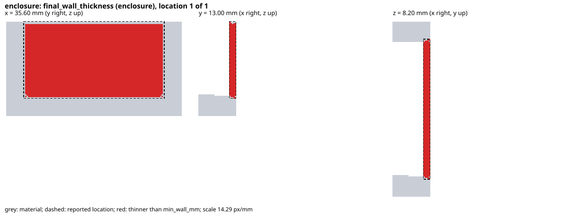 |
| 細い接続部 (`narrow_neck`) | 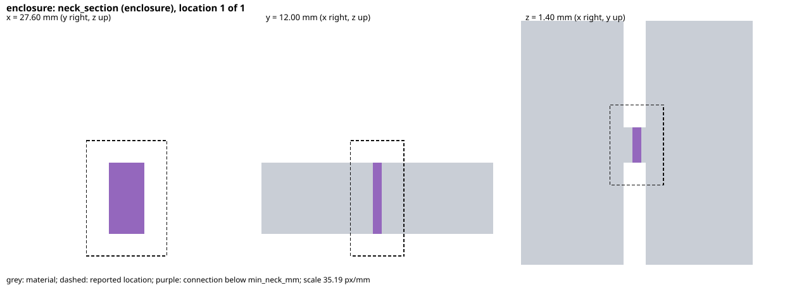 |
| 切り離された部分 (`severed_corner`) | 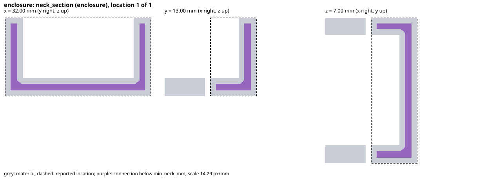 |
| 支持のない張り出し (`cantilever`) | 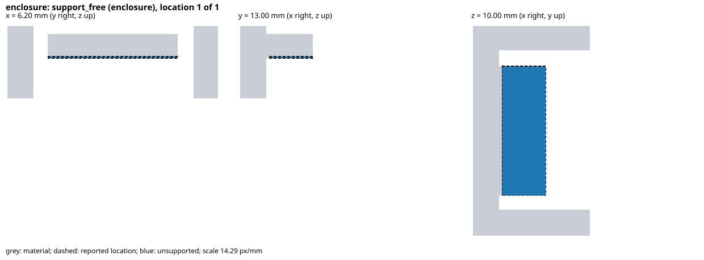 |
| 閉空洞 (`sealed_void`) | 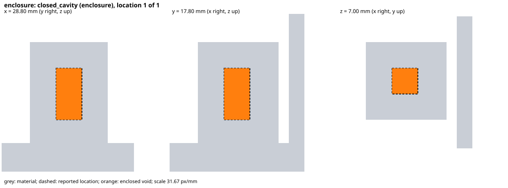 |

図は`scripts/render-figures.py --output docs/assets/figures --defects-only`で再生成する。

**投影図**: `figures/projection/`に、組立状態の全部品の概観 (`overview.svg`) と、検出箇所を持つfailしたcheckごとの図を書く。図は平面図、等角図、正面図、右側面図を同じ縮尺で2×2に並べる。部品の線はOCCTの隠線処理 (HLR) で求め、見える線を実線、隠れる線を破線で描く。検出箇所 (赤) とkeepoutの箱 (緑、clearanceを含まない) は隠線処理をせずに同じ投影で描く。検出箇所は部品の内部にあることが多いためである。部品の隠線処理は方向ごとに1回だけ行い、図ごとに使い回す。断面図と異なりvoxel格子を経由しないため、格子より細かい形状も現れる。backendが例外で止まった場合は形状がなく、投影図を書かない。cutで材料が残らない部品は外接boxを持たないため描かず、そのような部品しかなければ投影図を書かない。この場合もreportと断面図は書く。`build`の結果からは`typedsolid.cadquery.write_projection_figures`で書ける。

| 欠陥 | 図 |
| --- | --- |
| 蓋が壁に食い込む (`lid_overlap`) | 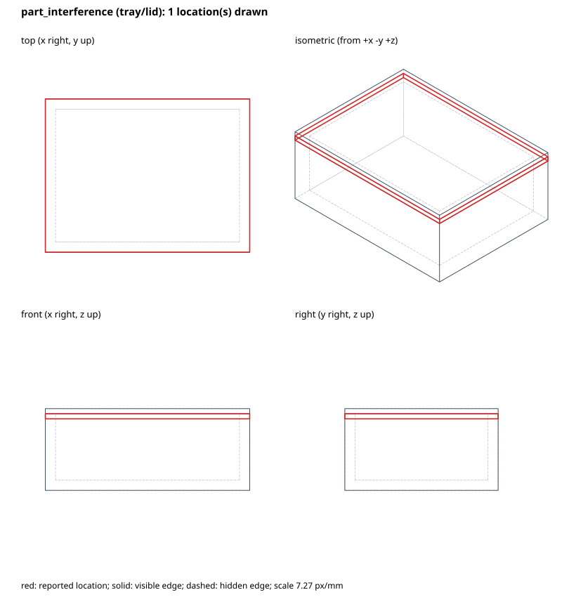 |
| ケーブルの経路を壁が塞ぐ (`blocked_cable`) | 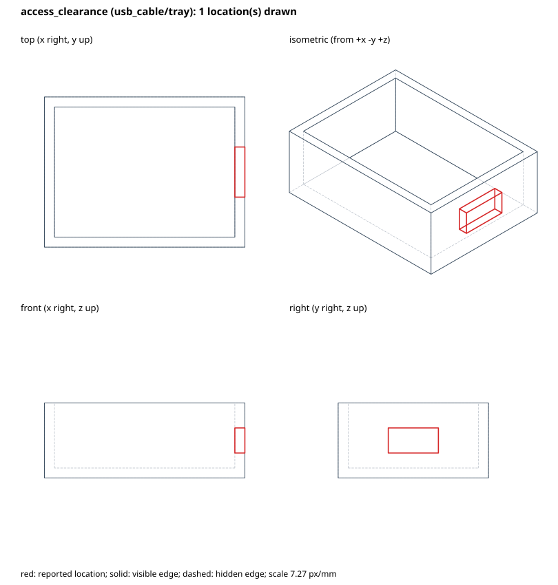 |
| 柱が基板の確保領域に入る (`post_in_keepout`) | 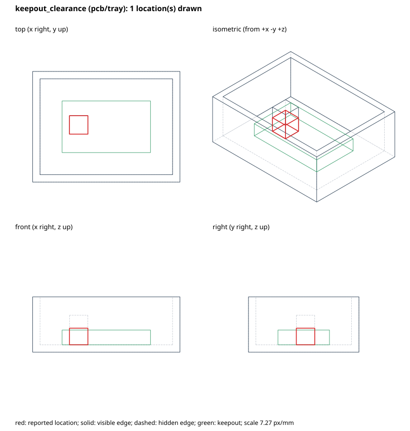 |
| 引き抜く板を壁が塞ぐ (`sliding_lid`) | 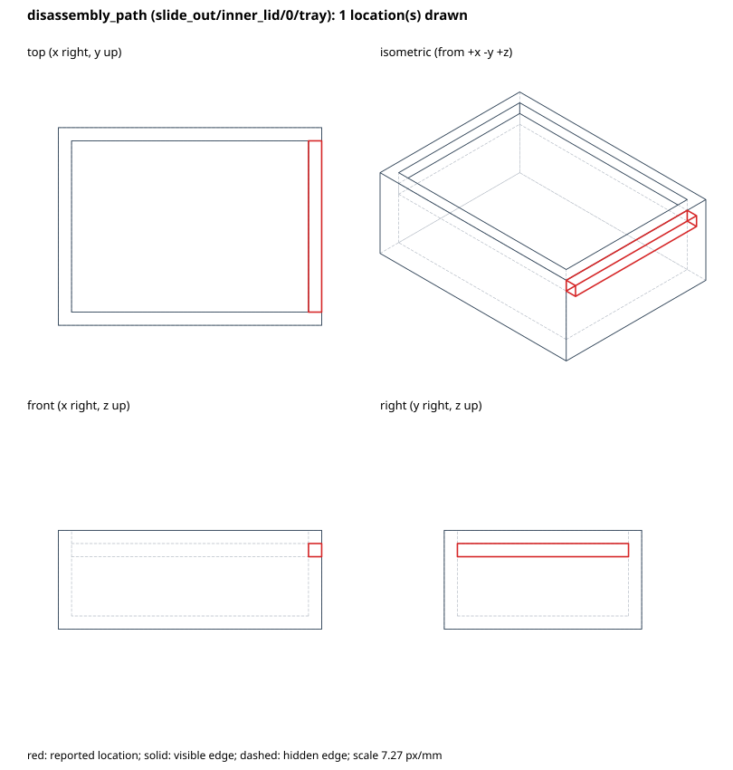 |

fixtureは`examples/assembly_defects.py`が持ち、`tests/test_projection.py`が不合格となるruleと検出箇所の座標を照合する。図は`scripts/render-projections.py --output docs/assets/projections`で再生成する。CIのintegration jobが再生成してdocsの図と比べる。

**出力の拒否と図**: `export`は検査で出力を拒否した場合も出力先を作らない。代わりに、reportと図だけを隣の`<出力先>.rejected/`に書き、例外にその場所を注記する。STL/STEPは書かない。`<出力先>.rejected/`が既にある場合は置き換えず、その旨を注記する。`export(..., figures=False)`で図を省ける。

第三者の筐体の図は、形状の派生画像となるため文書に載せない。利用者が手元で`typedsolid.external`の`--figures`を使って確かめる。

### 3D viewer

`export`は`figures/viewer.html`に、部品のmesh、keepout、全checkと検出箇所を埋め込んだ1つのHTMLを書く。外部のSTL/STEPでは`typedsolid.external`の`--figures`が同じviewerを書く ([外部形状への適用](#外部形状への適用))。外部の資源を読まず、`file://`のまま開ける。描画は自作のWebGL 1で行い、JavaScriptのpackageに依存しない。meshは最終形状をOCCTで三角形に分割したもので、許容誤差は部品全体の外接boxの対角長の0.1%である。描ける部品がない場合も、checkの一覧を見るために書く。拒否した出力でも`.rejected/`に残る。

- **check**: 状態 (fail と not evaluated、fail、not evaluated、pass、すべて)、rule、製造案、文字列 (rule、target、message の部分一致) で絞り込み、状態、rule、target、検出箇所の数で並べ替える。checkを選ぶとmessageと検出箇所の座標を示し、その検出箇所だけを赤く描く。選ばない間はfailしたcheckの検出箇所をすべて描く。画面上の赤い箱をclickすると、そのcheckを選ぶ。
- **製造案**: 既定では採用した案のcheckと製造案に依らないcheckを示す。製造案の選択で、すべての案、または1つの案 (と製造案に依らないcheck) に切り替える。採用していない案のcheckはtargetに案のidを添え、薄く示す。製造案を2件以上持つ部品がない場合は選択を出さない。
- **注視**: 検出箇所の`focus`で、その箇所を中心に、周囲を含む距離へ視点を寄せ、箇所を半透明の赤で塗る。
- **部品**: 部品ごとに表示と半透明を切り替える。検出箇所は部品の内部にあることが多いため、深度によらず手前に描く。keepoutは緑の線 (clearanceを含まない) で描く。
- **断面**: x、y、zのいずれかの平面より正の側 (反転で負の側) を描かない。切り口は部品色を暗くした地に45°の斜線を入れて塗り、半透明の部品では切り口も同じ透明度で描く。切り口は、部品ごとに断面より残す側の面を深度によらず数えてstencilの偶奇を反転し、奇数の画素 (断面の平面が部品の内部にある画素) だけに平面を塗って求める。meshが閉じていることを前提とし、閉じていない部分では切り口が欠けるか余分に塗られる。stencilを得られない環境では切り口を描かず、切り口から見える部品の内面を灰色で描く。
- **操作**: dragで回転、右dragまたはshift+dragで平行移動、wheelまたはpinchで拡大する。

表示状態はURL fragmentに書く。例えば`viewer.html#check=12&loc=0&clip=z:8&ghost=tray`は、12番目 (0始まり、reportの順) のcheckを選び、その最初の検出箇所を注視し、z=8 mmで切り、`tray`を半透明にした表示である。製造案の選択は`plan=*` (すべて) か`plan=<id>`で書く。同じURLを開くと同じ表示になり、利用者間で表示を共有できる。平行移動は記録しない。

DOMとWebGLに依存しない処理 (行列、データの復号、fragmentの解釈と書き出し、checkの絞り込みと並べ替え、picking) は`viewer_core.js`に分け、`tests/js/`のnode:testで検査する。描画は`scripts/check-viewer.py`が、部品間の欠陥fixture、複数の欠陥を持つRaspberry Pi 4の筐体、その底をSTLに書き出して外部形状の経路で検査したものを、版を固定したChromiumで撮影し、表示状態ごとに部品、検出箇所、断面の色が画面に現れることを確かめる。

| 表示 | 画像 |
| --- | --- |
| checkの選択と部品の半透明 (`post_in_keepout`) | 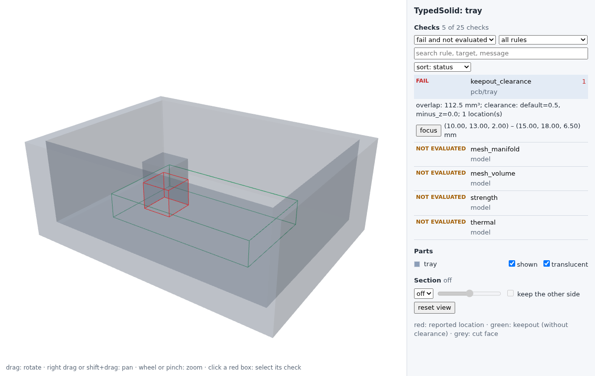 |
| z方向の断面 (`lid_overlap`) | 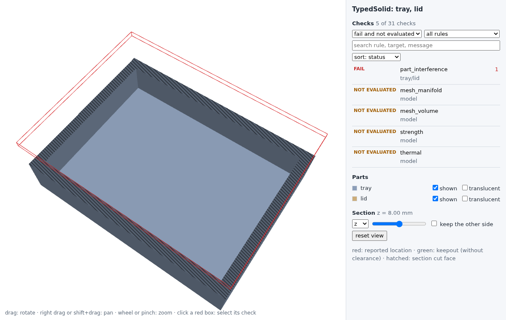 |
| 複数の欠陥を持つ2部品の筐体の概観 (`pi4_enclosure_defects`) | 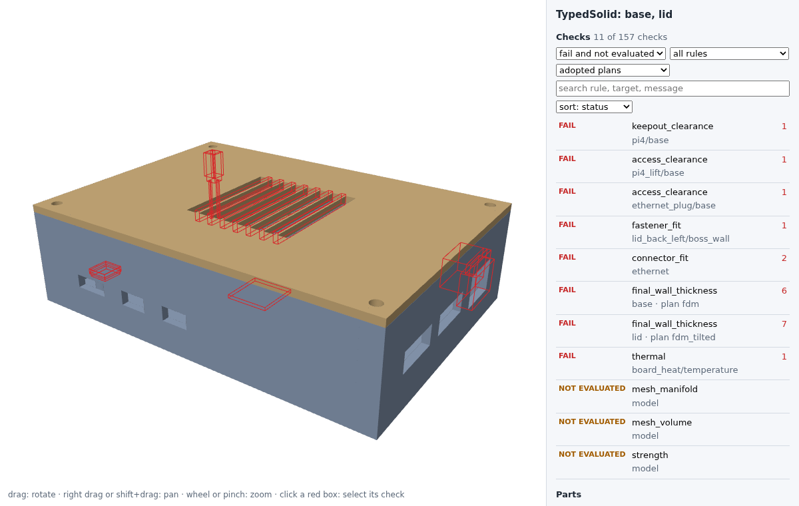 |

**Raspberry Pi 4の筐体**: `examples/pi4_enclosure.py`は、部品catalogのRaspberry Pi 4 Model Bの外形、取付穴、コネクタ位置から作る底と蓋の2部品の筐体である。蓋を四隅の柱へ4本のネジで、基板を底の4本のbossへネジで締め、底の壁に6個のコネクタ開口と、プラグを抜く掃引を持つ。蓋には通気スリットを開け、下面に底の壁の内側へ差し込むlipを持つ。さらに背面の2本のsnap fitが蓋から垂れ、先端のフックが底の背面の窓に掛かる。基板の高さ、PCBの厚み、コネクタの高さとプラグの断面、ネジの寸法、印刷機の特性 (bridge 15 mm、張り出し55°)、材料の許容ひずみ、光造形・切削・射出成形の特性は作例が決めた説明用の値である。

製造案は部品ごとに持つ。蓋は裏返し、前面の上の辺を造形板に寄せて50°傾けたFDMの案 (`fdm_tilted`、`up = minus_z`、`turn_deg = 180`、`tilt_deg = 50`) を採用する。snap fitの梁は積層方向から50°離れ`layer`に合格し、蓋の縦の面は鉛直から50°張り出して印刷機の55°に収まる。前方へ傾けると、フックの外側の上の稜線が最初に積む位置となり宙に浮くため、後方へ傾ける。比較のため、裏返しただけの案 (`fdm_upside_down`) と上向きの案 (`fdm_upright`) を持つ。前者は梁が積層方向に沿って`layer`で不合格となり、フックの下面も支えを持たず`support_free`で不合格となる。後者はさらにlipの上の天板が支えを持たない。底はFDMの案 (`fdm`) を採用し、比較のため光造形 (`resin`)、切削 (`milling`)、射出成形 (`molding`) の案を持つ。

- 光造形: 開いた箱を上向きに造形すると、内側が造形中に槽の底との間で閉じるため、`resin_suction`で不合格となる。
- 切削: 上面と、コネクタ開口とsnap fitの窓のある`minus_y`、`plus_x`、`plus_y`の3面から直径3 mmの工具を下ろす。どこへも届き`milling_reach`には合格するが、ネジ柱と壁の間の内角とφ2.1 mmの下穴を工具の径で削れず`milling_corner`で不合格となる。
- 射出成形: 型を`z`軸に沿って開く。壁の6つの開口とsnap fitの2つの窓が`mold_undercut`で、壁の角と一体になった四隅のネジ柱が`mold_thick_wall` (最大肉厚3 mm) で不合格となる。抜き勾配はnot_evaluatedである。

正常版 (`pi4_enclosure`) は採用した案ですべてのruleに合格し、部品間の検査はいずれも実際の対象で評価される。欠陥版 (`pi4_enclosure_defects`) は、蓋の通気スリットの桟、床の削り込み、細いネジ柱、基板のbossに載せたshim、下へずらしたEthernetの開口の5つの欠陥を同時に持ち、採用した案では2部品にまたがって7 ruleの8 checkが不合格となる。床の削り込みは、底の熱の解析でも上限を超える。`tests/test_pi4_enclosure.py`が採用した案と採用していない案のそれぞれで不合格となる検査項目の集合を照合し、`scripts/check-viewer.py`が欠陥版のviewerを撮影する。

## 着脱の検査

分解stepごとに、動かす部品の最終形状を区間ごとに掃引し、残っている部品との共通体積を求める。判定はOCCTのBooleanで行う。はめ合い隙間は0.2〜0.3 mm程度でvoxelの既定pitchと同じ桁にあり、量子化を失敗側に倒すと要件を満たす設計も不合格となるためである。

| rule | 内容 |
| --- | --- |
| `disassembly_path` | 各区間の掃引体積が、残っている部品と共通体積を持たない |
| `disassembly_separation` | 最後の区間の方向へ外まで動かし続けても干渉しない。部品が経路の終端で外れていることを表す |

**keepout**は箱そのもの (clearanceを含まない) を障害物とする。clearanceは静止状態での設計余裕として`keepout_clearance`だけで使い、移動中の隙間は`fit_clearance_mm`で見る。両方を適用すると余裕を二重に取ることになるためである。取付先の部品を動かすstepでは、keepoutはその部品と一緒に動き、他の部品や残っているkeepoutとの干渉を検査する。targetでは`keepout:<id>`と書き、部品のidと区別する。`"exit"`の距離は残っているkeepoutの外までを含む。

`disassembly_separation`はAABBの分離では判定しない。L字の土台の切り欠きから横へ抜く場合のように、外れた部品がAABBの内側に残る形があるためである。

**はめ合い隙間**は距離ではなく体積で判定する。最短距離では、蓋が壁の上に載る接触も距離0となり、要件を満たす設計も不合格となる。動かす部品を移動方向に垂直な2軸にだけ`fit_clearance_mm`広げてから掃引し、共通体積を見る。移動方向の手前にある載置面の接触は体積0のまま残り、横ですれ違う面の隙間不足だけが検出される。広げる形は辺長2·clearanceの正方形とのMinkowski和で、円とのMinkowski和より保守的である。

隙間の要求は移動方向に平行な面すべてに掛かる。スライドする蓋が載っている面を滑る場合、その面も隙間を要求される。載置面を滑る区間を持つstepでは、そのstepの`fit_clearance_mm`を0とする。

**掃引体積**は、元の形状、終点の形状、移動方向と平行でない各faceのprismの和として作る。OCCTはsolidのprismを扱わない。境界を横切る線分は移動方向と交差するfaceを通るため、この和は測度0の差を除いて掃引体積に一致する。閉じた円筒面を垂直方向に押し出すと自己交差するため、円筒軸を通り移動方向に垂直な平面で先に分割し、各半面の法線が移動方向に対して一定の向きを持つようにする。cutを反映した最終形状そのものを掃引するため、蓋の穴を柱が通る形も正しく扱う。穴あき板と円柱の掃引体積が解析値と小数第6位まで一致することをtestで確認している。

## 掃引の検査

`access_clearance`は各掃引の領域が、その状態で残っている部品と共通体積を持たないことを見る。掃引体積は着脱の検査と同じ関数で作る。`"exit"`は残っている部品のAABBの外へ2 mmの余裕をもって出る距離である。keepoutを参照する掃引は、v3までのaccessと同じくclearance込みのboxを外まで動かす。

掃引は部品だけを障害物とし、keepoutを障害物としない。USBプラグのように、keepoutとして確保した基板上のコネクタへ差し込む掃引があるためである。keepoutを参照する掃引は、そのkeepoutが評価する状態で残っていることを要求する。取付先の部品を`after_step`までに外している場合は、keepoutも一緒に取り除かれているため、検証で拒否する。

## ネジ固定の検査

`fastener_fit`は組立完了の状態で、ネジ1本ごとに次の5項目を`<fastener>/<項目>`のtargetで報告する。判定は着脱と同じくOCCTのBooleanで行う。下穴の径とねじ山の差は0.3〜0.5 mm程度で、voxelの量子化に埋もれるためである。

| 項目 | 内容 |
| --- | --- |
| `through` | 座面から境目まで、貫通穴径の円柱にclampの材料がない。ネジがclampに噛むと締め付けにならないため、外径でなく貫通穴径で見る |
| `bearing` | 貫通穴径から頭径までの輪帯が、座面から0.5 mm (clampがそれより薄ければその厚み) clampの材料で埋まっている |
| `engagement` | セルフタップは、境目から先端までの下穴径〜外径の輪帯とbaseの共通体積を輪帯の断面積で割った長さ。インサートは、境目を越えたネジの長さとインサート長の小さい方。いずれも`min_engagement_mm`以上 |
| `clear_tip` | 下穴 (インサートの場合はインサート穴と、その先のネジ外径の経路) にbaseの材料がない。先端が底に当たると締め付けにならない |
| `boss_wall` | 下穴径またはインサート穴径の周囲`min_boss_wall_mm`の輪帯が、ねじ山のかかる範囲 (インサートはインサート長) でbaseの材料で埋まっている |

「材料で埋まっている」は、不足体積が1e-7 mm³と期待体積の1e-6倍の大きい方以下であることとする。円筒面が一致する境界の演算誤差を吸収するためであり、穴や肉の寸法不足を許す値ではない。

`clamp`が空の場合、`through`と`bearing`は対象が記述されていないことを明記してpassとする。ネジが境目を越えない場合、`boss_wall`は評価範囲がないため`not_evaluated`とし、出力を拒否する。

### ネジを外す順序

`Fastener.release`はネジを外す状態を表す。`{"after_step": "open_lid"}`はそのstepを終えた状態で、`{}`は組立完了の状態で外す。省略するとネジは外さない。`Sweep.after_step`と同じ状態の表し方であり、蓋を外した後にネジを外して基板を抜く、といった手順を書ける。`Fastener.clamp_keepouts`は、ネジで締めているkeepout (基板など部品として記述しない物) である。

`fastener_release`は、ネジ1本ごとに`<fastener>/release`で次を見る。形状を使わないため、Rust coreが判定する。

- ネジを外すより前のstepで、base、clampの部品、締めているkeepoutのいずれかを他と別々に動かさない。keepoutは取付先の部品と一緒に動く。全員を同じstepで動かすことは許す。
- 締めているkeepoutを取り出す`Sweep`を、ネジを外す前の状態で評価しない。

`screw_fixing`に`release`を与えると、ドライバの掃引をネジを外す状態で作る。

検査するのは宣言した寸法と形状の整合であり、締結力、ねじ山の強度、インサートの引き抜き強度は評価しない。ドライバの通り道は`Sweep`として別に宣言し、`access_clearance`で検査する。Python APIの`screw_fixing`は、bossと下穴、貫通穴、ドライバの掃引、`Fastener`を同じ寸法から作る。

## 最終形状の検査

`final_wall_thickness`、`neck_section`、`closed_cavity`、`support_free`はIRから直接rasterizeしたvoxel上で判定する。OCCTのface/edge topologyに依存せず、boxとcylinderの内外判定だけで最終形状を得る。Boolean後のface対応を推測しないという方針と整合する。

格子の間隔は`policy.voxel_mm` (既定0.2 mm)、cell数の上限は1 partあたり2億である。上限を超える入力はvalidateで拒否する。cellはvoxel中心で内外を判定するため、形状は最大で格子の半分だけ外側へ膨らむ。要求値に格子1つ分を足して判定し、量子化の誤差を失敗側へ倒す。格子より小さい形状は評価できず、`neck_section`がfailするため出力は拒否される。

製造法に依る検査 ([製造案](#製造案)の表) は、部品の製造案ごとに、その案の値と姿勢で評価する ([製造案](#製造案))。格子と製造法に依らない検査の結果は部品ごとに1回だけ求め、案の間で共有する。

- `final_wall_thickness`: 表面の法線方向に材料を横切る長さを肉厚とする。符号付き距離場 (材料の内側では空cellまでの距離、外側では材料までの距離の負値) を5 cellの二項係数で平滑化し、その中心差分を表面cellでの内向きの法線とする。表面cellの中心から法線の向きへ1/4 cellずつ進み、空cellに入るまでの長さに表面までの半cellを加えた値が`min_wall_mm`に格子1つ分を加えた値に満たなければ、通ったcellを薄肉とする。勾配が定まらない孤立したcellは薄肉とする。凸の稜線では法線が対角を向くため長く測れ、稜線を薄肉と誤らない。傾いた壁と円柱の外周も壁の法線の向きで測る。平滑化は、格子化した小さな穴の段差で法線が乱れ、穴の周りの肉を斜めに短く測ることを防ぐ。内接球の直径で測る方法は、凸の稜線で球が角まで入れず稜線を薄肉と判定するため採らない。
- `neck_section`: 半径`min_neck_mm / 2`でerosionし、6-連結の連結成分が1つに保たれるかを見る。分かれる場合は、その断面で繋がる細い接続部がある。距離場はFelzenszwalb-Huttenlocherの下位包絡線法で求める厳密なEuclidean距離であり、chamfer近似のような方向依存の誤差を持たない。
- `closed_cavity`: 空cellを格子の外周から6-連結でflood fillし、到達できない空領域を閉空洞とする。格子より細い隙間を通じて外部に通じる空洞は、閉じていると判定される。
- `support_free`: 製造案の`orientation.up`の軸で層に分け、各cellが下の層の材料に支えられるかを見る。m層下の水平距離m·`tan(overhang_angle_deg)` cell以内に材料があり、途中のj層下 (j < m) にも水平距離j·`tan(overhang_angle_deg)` + 1 cell以内に材料があれば支持されているとする。mは1〜8を試す。傾いた面の位置は層ごとに格子へ丸められ、1層あたりのずれが最大1 cell揺らぐため、1層だけで傾きを測ると許容角より緩い面でも未支持の層が出る。複数層の傾きで判定し、この揺らぎを均す。途中の層の条件は、片持ちの棚の下に離れて立つ壁を支持と誤らないためであり、水平な棚では壁から2 cellまでを支持とみなす。層内の距離は層ごとの2次元の距離変換で求める。材料が最初に現れる層はbuild plateに接するものとして支持済みとする。下の層が支持されているかは問わない。支持の要否は層ごとに独立して評価し、1箇所のoverhangがその上の全体を未支持にすることを避ける。未支持のcellは、同じ層で両端を支持された材料に挟まれ、両端の間が`bridge_max_mm`以内であればbridgeとして渡せるものとする。傾けた格子では渡す向きが格子の軸に沿わないため、層内の16方向について、未支持のcellから両側へ進んで支持された材料に当たるかを見る。格子化した板の縁は段になるため、進む線の両脇1 cellに未支持の材料があれば進み続ける。端で終わる区間は片持ちでありbridgeにならない。
- `resin_drain` (UV樹脂の案に限る): 空cellのうち、材料から`(min_drain_mm + voxel_mm) / 2`以上離れたものを格子の外周から6-連結で辿る。辿れないcellは、幅`min_drain_mm`の球が外から入れない奥にあり、未硬化樹脂を排出できない。閉空洞は`closed_cavity`が扱うため除く。要求値に格子1つ分を足し、通路の幅を失敗側へ倒す。
- `resin_suction` (UV樹脂の案に限る): `orientation.up`の軸で、材料が最初に現れる層 (造形板に接する層) から順に層を加え、それまでの層の空cellを連結する。加えた層の空cellの成分が格子の側面に触れていなければ、その層を槽の底で硬化する時点で、造形板の側が閉じた空間 (椀) となり、剥離時に吸盤として働く。幅`min_drain_mm`の球が収まらない細い椀は除く。逃がし穴の要否と位置の判断に使い、剥離力は評価しない。
- `milling_reach`、`milling_corner` (切削の案に限る): 素材を材料の外接boxとし、素材内の空cellが削れるかを段取りごとに求め、和を取る。段取りの`up`の軸で、各列の材料の最上cellより上を工具の先端が下りられる範囲とする。直径`tool_diameter_mm`の工具の先端は、工具の円板が覆う列のうち最も高い材料より上にしか下りられない。素材の上面から`tool_length_mm`より深くへは届かない。径0の工具でも削れない空cellを`milling_reach` (undercut、届かない深さ、閉空洞) に、径0なら削れるが工具の径では削れない空cellを`milling_corner` (半径`tool_diameter_mm / 2`未満の縦の内角、工具より細い溝や穴) に数える。工具の半径に半cellを加え、届く深さを切り捨てて失敗側へ倒す。工具の円板は行ごとの区間に分けて走査し、計算量を平面の点数と円板の行数の積に抑える。工具軸に垂直な層で8-連結の2 cell以下の削り残しは、格子化した円弧と円板の差として数えない。工具の半径が1.5 cellを超えれば、鋭い内角は層内で3 cell以上を削り残すため検出される。平端の工具の底の角は鋭いため、床と壁の境は削り残さない。
- `mold_undercut` (射出成形の案に限る): `up`の軸の各列で、最初と最後の材料の間にある空cellを、型を開く軸のどちら側へも抜けない空間とする。2枚型をまっすぐ開くことだけを考え、スライドなどの側方の型は扱わない。
- `mold_thick_wall` (射出成形の案に限る): 材料cellから空cellの中心までの距離をdとし、内接球の直径を表面までの半cellを除いた(2d - 1) cellと見積もる。これに格子1つ分を加えた2d cellが`max_wall_mm`を超える材料を厚肉の芯とする。内接球で測るため、壁の角を厚肉と誤らない。格子化で壁は最大1 cell厚くなるため、厚さ2 mmの壁の交差部は`voxel_mm` 0.5で3 mmを超えうる。
- `mold_draft` (射出成形の案に限る): 抜き勾配。軸平行のboxとcylinderは型の開く向きに平行な面に勾配を持たないため評価せず、not_evaluatedとする。

`support_free`はノズル径、層厚、冷却、材料といったslicerとプリンタの条件を含まない。UV樹脂の案でも同じ層の判定を用い、樹脂のsupportの配置や剥離力は扱わない。判定は幾何のみに基づく保守的な近似であり、実際に支持なしで印刷できることを保証しない。slicerでの評価との突合は`docs/development.md`の手順による。

### 外部形状への適用

既存の筐体と比較するため、IRを介さずにSTL (binary又はASCII) とSTEPへ同じ4 ruleと、製造法ごとのruleを適用できる (`typedsolid.external`)。製造案は1件を与え、採用した案として扱う。STEPはCadQueryで読み、弦誤差`voxel_mm/4`で三角形分割してから同じ経路で評価する。座標の単位はmmとみなす。IRの意味を要する検査 (keepout、掃引、分解、ネジ、snap fit、コネクタ開口) と`single_solid`、`valid_solid`は行わない。

- **meshの内外**: 各(x, y) cell中心から+z方向の直線とmeshの交点を求め、winding numberが正の区間を内部とする。外向きの法線が-z成分を持つ面で+1、+z成分を持つ面で-1とする。重なった複数のsolidは和として、内向きの面で囲んだ空洞は空洞として扱う。偶奇則では重なりが外側になるため採らない。
- **共有辺の扱い**: xy平面へ投影した三角形の内外判定では、辺上の点を辺の向きで一方の三角形だけに割り当てる。辺ごとの符号付き面積は端点を辞書順に並べてから計算し、隣り合う三角形が丸め誤差で同じ交点を二重に数えることを防ぐ。
- **格子**: meshの外接boxから半cellずらし、軸平行な面がcell中心を通らないようにする。IRのrasterizeとはcell中心の位置が異なるため、境界に接する形状では占有cell数が一致しない。
- **図とviewer**: `--figures DIR`で、断面図と3D viewer (`viewer.html`) をDIRへ書く。viewerは判定に使ったSTLの三角形をそのまま描き、間引かない (STEPは判定と同じ分割)。三角形の読み出しはRust coreのSTL parserが行い、CadQueryを読み込まない。CLIはviewerの三角形数と大きさを標準エラーに書く。100万三角形で約50 MBが目安である。
- **拒否する入力**: 向き付きで対にならない辺があるmesh (閉じていないか、向きが不整合) と、winding numberが負になるか0に戻らない列があるmesh (向きが不整合) は評価せず拒否する。長さ0の辺は面を区切らないため数えない。T字接続 (隣の三角形の辺の途中に頂点がある) のmeshは、幾何的に閉じていても辺が対にならないため拒否される。

**斜めの壁の肉厚**: `final_wall_thickness`は表面の法線方向に厚さを測るため、軸に対して傾いた壁も壁の厚さで判定する。[既存ケースとの比較](comparison.md)の結果は、軸方向の連続長で厚さを測っていた版で得たものである。

## 出力meshの検査

`mesh_manifold`と`mesh_volume`はbackendが書き出したSTLを対象とする。設計入力ではなく出力表現の検査であり、STLが存在するexport時にのみ評価できる。`build`の時点ではnot_evaluatedとして残る。標準policyのrequiredには含めないが、failは他の検査と同様に出力を拒否するため、exportは常にこの検査を通過した結果だけを配置する。

`mesh_manifold`は各有向edgeが1回、その逆向きも1回だけ現れること (閉じた向き整合)、退化三角形がないこと、連結成分が1つであることを検査する。`mesh_volume`はmeshの符号付き体積を発散定理で求め、solid体積との相対差を`policy.mesh_volume_tolerance` (既定0.01) と比較する。符号が負の場合は全体の向きが内向きであることを示す。

頂点はf32のbit patternで同一視する (-0.0は+0.0に正規化)。同一座標を異なるfloatで書いたmeshは隣接を検出できず非manifoldと判定される。この判定は安全側に倒れる。binary STLのみを対象とし、ASCII STLは長さ不一致として拒否する。解析失敗は例外にせず、failのcheckとして保持する。

この検査はmeshが閉じた単一の立体であることを確認するものであり、自己交差、印刷可能性、slicer上の挙動を保証しない。

`export(model, directory)`はモデルを再buildして検査する。利用者が変更可能な`Build.report`をexportの証拠として再利用しない。既存出力ディレクトリを上書きせず、検査とファイル生成が完了した後に新規ディレクトリへ配置する。STL/STEPのほか、意味モデルの`model.json`、検査・backend版・ファイルSHA-256を含む`report.json`を保存する。`model_sha256`は保存した`model.json`のbytesそのもののdigestであり、利用者は保存ファイルの再hashで照合できる。

## CadQuery/OCCT依存への対策

永続的な意味IDはIRのPart/Featureに置き、face番号やedge列挙順に置かない。primitiveは軸平行のboxとcylinderに限定し、fragileなface selectorを使用しない。Boolean後のface→feature対応は現段階で保証しない。

backend例外、無効形状、空形状をfailとして保持する。依存を固定し、版更新時は孤立・切断・空形状・干渉・アクセス・STEP再読込の回帰テストを行う。STLのバイト一致ではなく、寸法・体積・接続性と検査結果を比較する。

カーネルのhard crashやhangはPython例外処理では隔離できない。`export`はbackendを子processで実行し、親がtimeoutで打ち切る。子は`python -m typedsolid._worker_entry`として新しいinterpreterで起動し、targetをmodule名と関数名で受け取る。OCCTが内部に持つthreadの状態を複製するforkは使わない。multiprocessingのspawnも使わない。spawnは子の起動時に呼び出し元の`__main__`を読み込み直すため、`if __name__ == "__main__"`の無いscriptでは子が同じscriptを再実行し、標準入力から実行した場合は読み込み自体に失敗する。親子の通信は専用のpipeで行い、標準出力は使わない。POSIXに限る。子の例外は同じ型で親へ戻し、結果を返さずに終了した子は`WorkerCrashed`とする。出力先のstagingは親が作成・破棄するため、打ち切られても一時出力が残らない。`build`は形状を呼び出し側へ返すため同一processで動き、打ち切りの対象外である。

部品単位の生成結果 (binary BREPとvoxel評価) は、指定した場合に限りcacheへ保存する。keyは部品のIR、voxel評価ではpolicyも含め、backendのsource、native module、CAD kernelの版から作るため、実装が変わると古い結果は参照されない。cacheから読んだ形状も新たに作った形状と同じ検査を通り、判定には関与しない。

## snap fitの検査

`snap_fit`はsnap fitごとに次の5項目を`<snap fit>/<項目>`のtargetで報告する。`strain`と`layer`は寸法だけで決まるためRust coreが判定し、他はbackendがOCCTのBooleanで判定する。

| 項目 | 内容 |
| --- | --- |
| `strain` | 梁の根元のひずみ ε = 1.5·t·y/L² が材料の`allowable_strain`以下 |
| `layer` | 梁の長さ方向と、梁を持つ部品の製造案の積層方向の間の角が45°以上である。製造案ごとに判定し、積層しない製造法では対象外のpassとする |
| `beam` | 梁とフックのboxが部品の最終形状の材料で埋まっている。cutで削られていない |
| `deflection_space` | 外すstepの直前の状態で、梁とフックを`deflection_mm`だけたわむ向きへ動かした掃引が、同じ部品の他の部分、他の部品、残っているkeepoutの箱に干渉しない |
| `retention` | たわませないフックと`mate`の相対運動が、外すstepの経路で干渉する。干渉しなければフックは何も保持していない |

**ひずみ**は、先端荷重を受ける一様矩形断面の片持ち梁で求める。たわみ δ = F·L³/(3·E·I) と根元の曲げ応力 σ = F·L·(t/2)/I から ε = σ/E = 3·t·δ/(2·L²) である。tはたわむ向きの厚み、yは`deflection_mm`、Lは根元からフックの根元側の端までの長さとする。荷重点を最も根元側に置くため、フックの範囲で荷重点が動く場合に対して保守側となる。根元の応力集中、テーパ梁、大変形は扱わない。応力集中を避ける根元の丸みは面取りと同じくedge選択に依存するため導入していない。

**積層方向**は、梁の長さ方向と積層方向の間の角が45°未満の場合をfailとする。梁が層の面より積層方向に近いと、根元の曲げ応力が主に層間を引き離す向きに掛かり、強度が一般に層内より低い層間の強度で決まるためである。軸平行の姿勢では、平行ならfail、直交ならpassとなる。`layer`のcheckは製造案ごとに`plan`を持ち、採用していない案の結果は出力の可否に用いない。

**取り外し経路**は分解の検査で評価する。外すstepでは、フックを`deflection_mm`だけたわむ向きへ平行に動かし、梁を同じ量だけ掃引した包絡を加えた部品で`disassembly_path`と`disassembly_separation`を評価する。曲がった梁はこの包絡に含まれ、経路に沿って掃引されるため、途中の障害物との干渉も検出する。根元は実際には動かないため保守側である。同じstepで同じ部品の複数のsnap fitを外す場合は、すべてのフックをたわませる。stepの後に部品が残る場合、フックは元の位置へ戻る。

分解stepに`fit_clearance_mm`を要求すると、たわんだフックと爪の横方向の隙間もその値を要求される。フックの張り出しと同じ`deflection_mm`では隙間が0となるため、張り出しにclearanceを加えた値を与えるか、そのstepの`fit_clearance_mm`を0とする。

Python APIの`snap_fit`は、根元の面の中心、寸法、向きから梁とフックのfeatureと`SnapFit`を作る。

## コネクタ開口の検査

`connector_fit`は、コネクタ開口ごとに`<connector>`のtargetで次を見る。IRの寸法だけで決まるため、Rust coreが判定する。いずれかがあればfailとし、messageに出典を載せる。

- 掃引の断面が`plug_mm`と一致しない。
- 開口の断面が、掃引の断面を各辺`clearance_mm`だけ広げた範囲を内包しない。
- プラグの後端が、開口の内側の面より奥から動き始めて外側の面の外まで抜けない。

開口の縁と壁以外の部品との干渉は、同じ掃引を使う`access_clearance`で評価する。`connector_fit`は、helperで作った開口や掃引を手で書き換えたときの寸法の不整合と、抜く向きの誤りを検出する。

プラグ外形の寸法は組み込まない。USB・HDMI等の規格書は、利用許諾が実装の評価目的に限られる、機密扱いである、有償で転載に許可を要する、のいずれかに当たり、公開するcatalogへの転記と両立しないためである。利用者は、使うプラグやケーブルの部品datasheetの値か実測値を、`source`に根拠を記して与える。

縦の壁に開けた開口の上縁はbridgeとなり、`support_free`が`bridge_max_mm`と照合する。開口の幅がこれを超える場合は、製造案の姿勢や開口の形を見直すか、slicerのbridge設定に合わせて製造案の`bridge_max_mm`を与える。

Python APIの`connector_opening`は、抜く向き、プラグ断面の中心と寸法、嵌合状態のプラグの範囲、切り欠く壁の範囲、clearance、出典から、cut feature、`Sweep`、`Connector`を作る。catalogの`Board.connector_center`は、資料が寸法化したコネクタの辺上の位置から`center`を求める。高さ方向の中心は資料が与えないため、呼び出し側が指定する。

## 解析

部品1つの線形弾性 (`StructuralCase`) と定常熱伝導 (`ThermalCase`) を、最終形状の検査と同じvoxel格子の上で解く。外部solverとmesherは使わず、Rust coreに実装した。候補としたscikit-femとMFEMはBSD-3であるが、四面体のmesherはいずれもcopyleft (GmshはGPL、fTetWildはMPL-2.0) であり、voxelの格子をそのまま要素とする方式を選んだ。

### 解析ケース

- `StructuralCase`は`id`、`part`、変位を0に拘束する`supports` (領域の列)、`forces` (領域と合計の力`newtons` [N])、許容応力を割る`safety_factor` (1〜100)、任意の`max_deflection_mm`、任意の`voxel_mm`を持つ。材料に`elastic`と`allowable_stress_mpa`が必要で、採用した製造案が積層する製造法 (FDM、光造形) なら`interlayer_allowable_stress_mpa`も必要である。
- `ThermalCase`は`id`、`part`、`heat_inputs` (領域と`watts`)、`fixed_temperatures` (領域と`celsius`)、`convection` (領域、熱伝達係数`h_w_per_m2k`、周囲温度`ambient_c`)、上限`max_temperature_c`、任意の`voxel_mm`を持つ。熱の出口として対流か固定温度が1つ以上必要である。異なる温度の固定温度の領域が節点を共有する場合は、記述順で解が変わるためnot_evaluatedとする。筐体内の空気は利用者が与える周囲温度として扱い、空気の流れは解かない。接触熱抵抗と放射は扱わない。
- 領域は`surface` (表面すべて)、`box` (軸平行のbox内の表面)、`fastener` (baseの部品では下穴の壁、clampの部品では頭の座面)、`keepout` (keepoutの箱に接する表面)、`connector` (コネクタ開口の縁) である。Boolean後の面番号は使わない。格子の露出した面のうち、面の中心が領域に入るものを選ぶ。参照による領域は、最も粗い格子の段を含めるため`2·voxel_mm`だけ広げる。1つの面は、先に書いた対流の領域にだけ属する。
- 力と熱量は、領域の表面へ一様に分布させる。

### 離散化と解法

- 材料のcellを8節点の六面体要素とし、cellの中心を部品のAABBの端から`(i + 1/2)·voxel_mm`に置く。最終形状の検査の格子は中心がAABBの端に乗り、各軸に1 pitch太くなるため、解析では使わない。
- 弾性の要素には非適合モード (Wilsonの要素) を加え、要素内で静的縮約する。完全積分の8節点要素は曲げで寄生的なせん断ひずみを生じて硬くなり、薄い壁を数要素で表す格子では変位を過小に見積もる。非適合モードは立方体の要素で純曲げを厳密に表す。
- 連立方程式は、voxelの階層 (2倍ずつ粗くした格子) による幾何マルチグリッドを前処理とする共役勾配法で解く。粗い格子の演算子は三重線形補間PによるGalerkin近似P^T A Pで、薄い壁が粗い格子で失われない。平滑化はD⁻¹AのChebyshev多項式で、最大固有値を格子ごとに冪乗法で見積もる。減衰Jacobi法は弾性の要素でD⁻¹Aの最大固有値が3.5〜4となり、係数0.6では高周波の誤差を増やした。要素ごとの積はz方向の区間に分けて並列に計算する。
- 拘束にも放熱にも接しない連結成分がある場合は、方程式が特異になるため解かずに未評価とする。
- 応力は要素の8隅で求める。平らな面の曲げでは表面の応力に当たる。

### 収束と判定

- 格子間隔h、2h、4hで解き、判定する量 (応力、層間の引張、変位、温度の上昇) について、hと2hの相対差が20%以下であり、かつhと2hの差が2hと4hの差の0.7倍以下である (収束の次数0.5以上) ことを求める。相対差が1%以下なら差の縮みは問わない。満たさなければnot_evaluatedとする。鋭い内角の応力は特異点であり、細分するほど値が増える。2段の比較だけでは、粗い格子で特異性の増え方が小さく、見逃した。
- 上限と比べる値は、hの値に、差が等比で縮むとみなした残りの和を加えたものとし、1次の収束に当たるhと2hの差を下限とする。細分で値が減る場合は外挿しない。
- 拘束と荷重の領域から各軸に`8·voxel_mm` (最も粗い格子の2 cell分) 以内のcellは、応力と層間の引張の判定から除く。拘束域の縁は理想化した境界条件による特異点であり、細分するほど応力が増える。除いた範囲は`<case>/boundary_stress`として常にnot_evaluatedで残し、その範囲の最大値をmessageに書く。
- 4hの格子でも部品と領域を表せる必要がある。`voxel_mm`の4倍より細い壁は最も粗い格子で消え、連結が切れるか領域が面を持たなくなり、not_evaluatedとなる。
- checkのtargetは`<case>/stress`、`<case>/interlayer` (積層する製造法のみ)、`<case>/deflection` (`max_deflection_mm`を与えた場合)、`<case>/boundary_stress`、`<case>/temperature`である。failでは、判定値と同じ比で外挿したcellの値が上限を超えたcellを検出箇所とする。

### 検証

| 問題 | 解析解 | 結果 |
|---|---|---|
| 引張棒 (20×6×6 mm、360 N) | σ = 10 MPa、δ = FL/(EA) = 0.2 mm | 一致 (表示桁の範囲) |
| 片持ち梁 (30×6×6 mm、先端1 N、ν = 0) | たわみ FL³/(3EI) + FL/(κGA) = 0.0853 mm | 0.0863 mm (+1.2%) |
| 同、拘束から4.5 mmの断面の曲げ応力 | F(L − x)c/I = 0.708 MPa | 0.701 MPa、判定値0.722 MPa |
| 一端加熱・他端固定温度の棒 | T = T₀ + QL/(kA) | 一致 |
| 同、他端を対流 | 膜の抵抗Q/(hA)を加えた値 | 一致 |
| L字の腕の付け根の内角 | 応力の特異点 | 1.31、1.62、2.12 MPaと増え、not_evaluated |

### 作例と制約

Raspberry Pi 4の筐体の底は、基板を締めるbossから0.05 Wを受け、外面から25 °C、内面から筐体内の空気40 °Cへ放熱する。0.5 mmの格子で最高温度は50.2、49.7、48.6 °C (h、2h、4h) と収束し、判定値50.7 °Cで上限55 °Cを満たす。解く時間は4 coreで約9秒である。床を0.8 mmに削った欠陥版は、熱が広がりにくく55.8 °Cとなり、不合格となる。

蓋を四隅のネジの座面で支え、天板の中央を20 Nで押すケースは収束しなかった。0.5 mmの格子で変位は1.085、0.946、1.038 mmと単調でなく、除外域の外の応力も16.9、10.9、12.1 MPaであった。厚さ2 mmの天板と通気スリットが4hの格子 (2 mm) で崩れ、スリットの端とlipの付け根の鋭い内角が特異点となるためである。解く時間は約3分であった。IRはfilletを持たないため、荷重を受ける接合部の応力はnot_evaluatedとなりやすい。作例は強度のケースを持たない。

接触、ネジの締結力、異方性 (層間以外)、大変形、座屈、放射、空気の流れは扱わない。印刷用STLを解析meshとして使わない。
